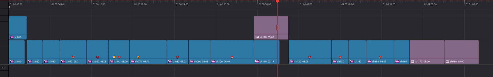
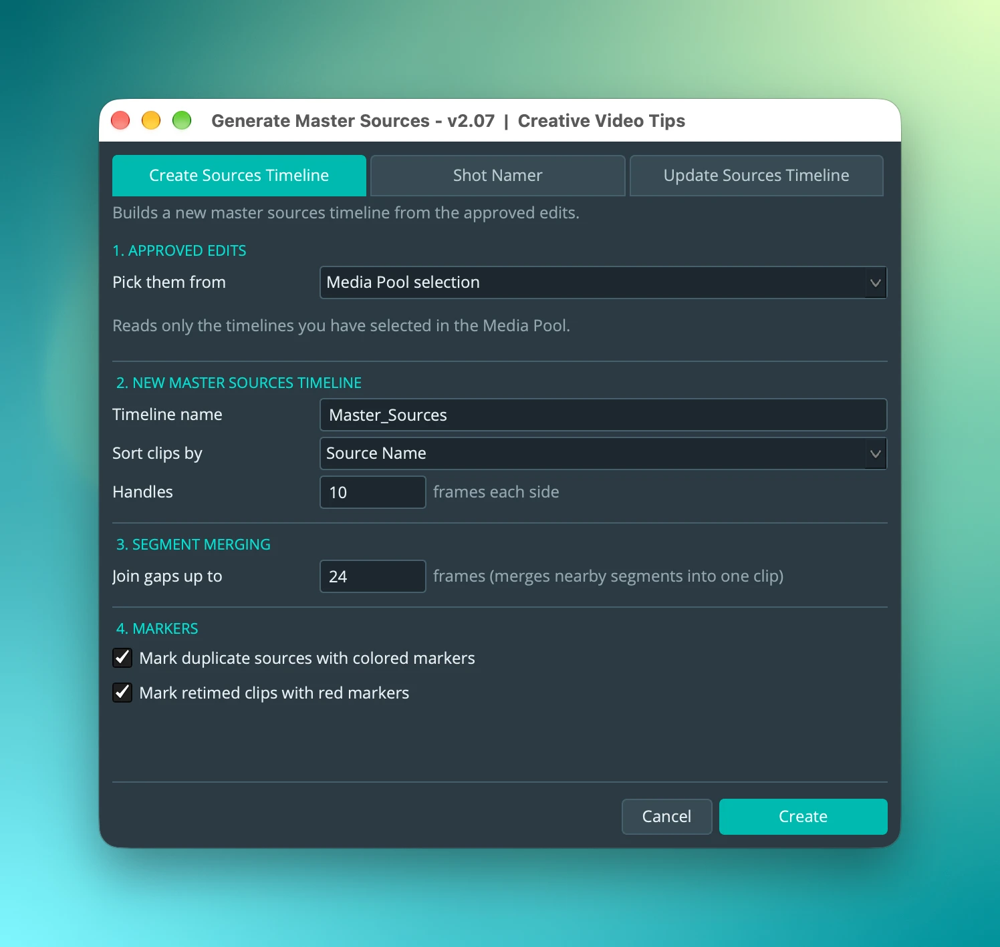
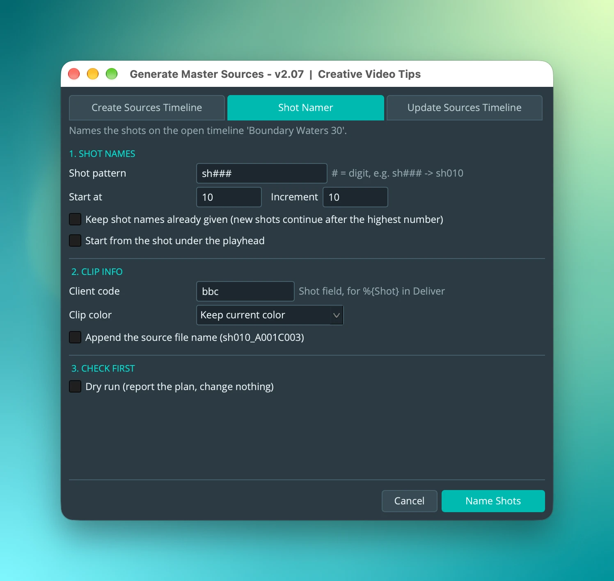
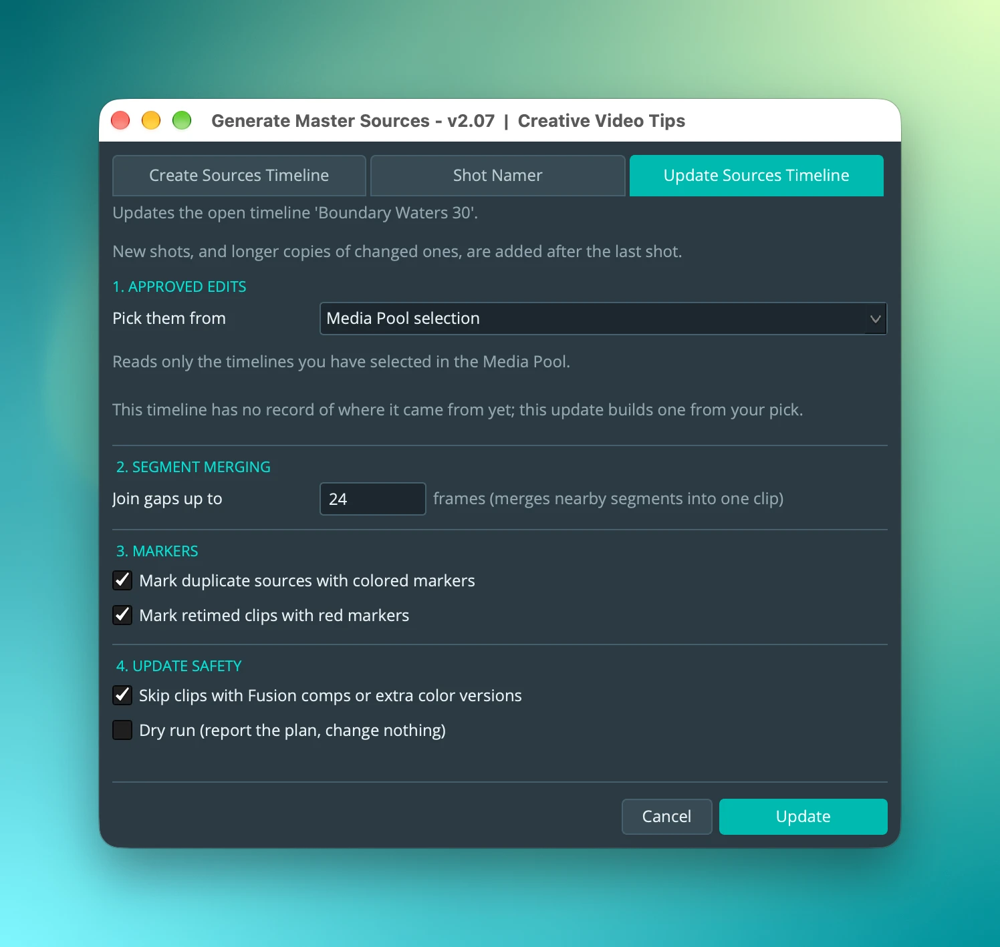
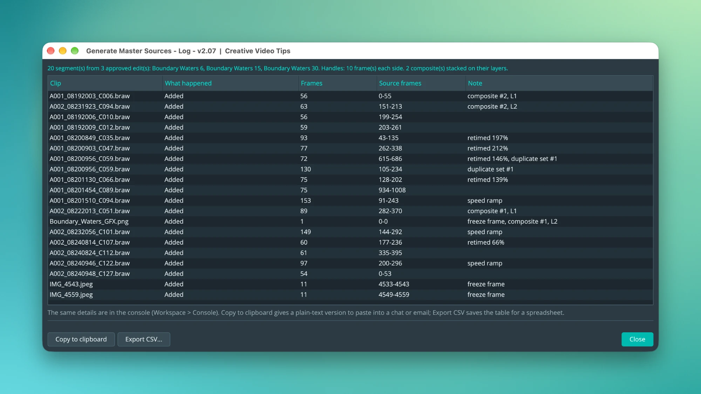

# CVT Generate Master Sources

A DaVinci Resolve Studio script that reads your approved edits and builds one
timeline holding every piece of source footage they use, ready to hand to VFX,
color or an online editor, then keeps that timeline up to date as the edit
changes.

From [Creative Video Tips](https://creativevideotips.com). Free software under
the GNU GPL v3 or later (see [License](#license)).

[Download the PDF guide](guide/cvt_generate_master_sources_README_v1.01.pdf)
(v1.01, for script v2.08). The same guide follows.

## Overview

A **master sources timeline** lists each stretch of source footage the edit uses exactly once, laid out one after another, so you can pull, name, send out and render every shot without hunting through the edit. The script works in three steps, one per tab:

1. **Create Sources Timeline** reads your **approved edits** (the edit timelines you picked) and builds the master.
2. **Shot Namer** gives the shots on the master their names (sh010, sh020 ...) and writes the source file name and a client code into each clip.
3. **Update Sources Timeline** brings the master up to date when a newer version of the edit arrives.

In the master:

- A stretch of a source file that the edit uses is a **segment**. Segments from nearby parts of one clip are merged into one.
- Every segment gets **handles**, extra frames before and after it, so Deliver's *Individual clips* export includes them.
- Every shot starts at frame **1001**.
- Segments that were composited together in an edit (stacked on different tracks) sit stacked at the same spot, so they read as one shot. The tracks are named **L1**, **L2** and so on.

The script reads video only. It needs **DaVinci Resolve Studio**, because it uses the scripting API. It was written and tested on Resolve Studio 21.1.2.

## Install

1. Copy `cvt_generate_master_sources_v2.08.py` into the Utility scripts folder:
   - macOS: `~/Library/Application Support/Blackmagic Design/DaVinci Resolve/Fusion/Scripts/Utility`
   - Windows: `%APPDATA%\Blackmagic Design\DaVinci Resolve\Support\Fusion\Scripts\Utility`
   - Linux: `~/.local/share/DaVinciResolve/Fusion/Scripts/Utility`
2. Remove any older version of the script from that folder, so the menu doesn't list both.
3. In Resolve, run it from **Workspace > Scripts > Generate Master Sources**.

The window opens in the middle of the screen. Your choices are remembered between runs, except Dry run.

## Before you start: set up the approved edits

The script reads **approved edits**, the timelines you consider final enough to pull from. The simplest way to work:

1. Make a bin and keep your current approved timelines in it. Move older versions out into another bin.
2. Open that bin in the Media Pool.
3. On the tab, set **Pick them from** to **Current bin**.

| Pick them from | What it reads |
| --- | --- |
| **Current bin** | Every timeline directly in the bin that is open in the Media Pool. Bins inside it are skipped, so move old versions into one. |
| **Media Pool selection** | Only the timelines you have selected in the Media Pool. |

Disabled clips, and clips on disabled tracks, are never included. Clip names are copied from the edits.

## Create Sources Timeline

Builds a new master from the approved edits. It has four sections.

### 1. Approved edits

**Pick them from** is explained above. A note under it says what will be read.

### 2. New master sources timeline

| Setting | What it does |
| --- | --- |
| **Timeline name** | The name of the new timeline. Default `Master_Sources`. |
| **Sort clips by** | **Source Name** sorts by clip name. **Source Timecode** lays the shots out in the order they were recorded, by each shot's first source timecode, across every clip and camera. **Edit Order (single timeline)** lays them out in the order they first appear in the edit, for a master built from one timeline. Still images always go at the end. |
| **Handles** | Extra source frames added before and after every segment (10 by default). They are plain source frames, so 10 means 10 even on a retimed shot. Handles stop at the start and end of the media, and handles that overlap join into one segment. |

### 3. Segment merging

**Join gaps up to** (24 frames by default). When the edit uses the same source more than once and no more than this many frames are left out between two uses, they become one segment that includes the frames in between.

For example, frames 100-200 and 210-300 of one clip leave 9 frames out (201-209), so at 24 they become one segment, 100-300. Higher joins more, giving fewer and longer segments. 0 joins only uses that touch or overlap.

### 4. Markers

| Option | What it does |
| --- | --- |
| **Mark duplicate sources with colored markers** | A source file that ends up in the master more than once, as separate segments, gets the same colored marker on each segment. `Dup Set #2 (1/3)` is segment 1 of 3 from set 2. |
| **Mark retimed clips with red markers** | Marks every retimed shot so you can check it by eye (see below). |

Click **Create**. When it finishes, a log opens (see [The log](#the-log)) and the window comes back on the Shot Namer tab, so you can name the new master straight away.

Here is a finished master after Shot Namer. Each shot is named (sh010, sh020 ...), starts on the same frame, and the layers sit on V1 and V2 (L1 and L2). Red markers are retimed shots, yellow markers are duplicate sources, and the purple clips at the end and on top are still images.

### What the master does with tricky clips

- **Speed changes, freeze frames and speed ramps** are found and given a red marker: `Retimed Clip` (with the speed), `Frame Hold`, `Non-Linear Retime` or `Extreme Retime` (a whip or fast ramp). A ramp's source range may not cover every frame it uses, so these are worth a look.
- **Reversed clips** are put in the master playing forward.
- **Transitions** such as dissolves get the extra source frames they use on each side of the cut, before handles are added.
- **Still images** get a **Purple** clip color and go at the end of a new master.
- **Composites** (layers stacked in an edit) are placed together on L1, L2 ... at one spot.

## Shot Namer

Names the shots on the **open** timeline, which is usually the master. The window names the timeline it will change.

### 1. Shot names

| Setting | What it does |
| --- | --- |
| **Shot pattern** | `#` stands for a digit, so `sh###` gives sh010, sh020 ... |
| **Start at / Increment** | The first number and the step between shots. |
| **Keep shot names already given** | On: a shot whose clips are already named from the pattern keeps its name, and new shots continue after the highest number, so an update's new shots follow on. Off: every shot is numbered again from **Start at**. |
| **Start from the shot under the playhead** | Starts naming at the shot the playhead is on. |

Clips stacked on L1, L2 ... are one shot and share one name.

### 2. Clip info

| Setting | What it does |
| --- | --- |
| **Client code** | A short code, such as `cfa`, written into each clip's **Shot** metadata field. Use the `%{Shot}` token in Deliver to start file names with it. Leave it empty to leave the field alone. |
| **Clip color** | Sets a clip color on every shot. **Keep current color** leaves colors as they are. |
| **Append the source file name** | Adds the source file to the shot name, as in `sh010_A001C003`. |

The source file name is always written into each clip's **Comments** as `Source: <file>`.

### 3. Check first

**Dry run** reports the plan and changes nothing. Click **Name Shots** to run it for real. The Shot Namer also names the tracks L1, L2 ...

## Update Sources Timeline

When a newer version of the edit arrives, open the master and use this tab. The window names the timeline it will update, and it only changes that one: if you switch to another timeline before it runs, it stops and changes nothing.

The rule to remember: **shots only ever get longer.** Frames you have already sent out for work are never cut. New shots, and longer copies of changed ones, are added after the last shot, on the track they belong to.

The settings match Create: the same approved-edits choice, **Join gaps up to** and the two marker options. The window offers the values the master was built with, because changing them between runs would make everything look changed. Update also keeps the handle length the master was built with. If the master has no record of where it came from yet, the window says so and builds one from your pick.

### What an update does

| When the edit... | The update... |
| --- | --- |
| uses a new source or a new stretch of one | adds a **new shot** at the end of the timeline (Mint marker) |
| now uses more frames of a shot | adds a **longer copy** at the end, and marks the original **Superseded** (Purple marker) |
| gained frames before the shot's start | marks the shot with a green marker, `Start frame 991` (10 more frames than before), so the render numbering stays consistent |
| uses fewer frames, or no longer uses a shot | leaves the shot at full length. A shot nobody uses any more gets a **no longer used** marker (Rose) and is never deleted |
| changes a still image already in the master | leaves it alone |

Resolve has no trim or move command, so changing a clip means deleting and re-appending it. The script puts the name, color, flags and markers back, but **a clip's grade and Fusion comps cannot be restored**: Resolve's scripting can't read a grade.

### 4. Update safety

| Option | What it does |
| --- | --- |
| **Skip clips with Fusion comps or extra color versions** | On (default): such a clip is left alone and gets a Fuchsia **Needs manual update** marker. Off: it is rebuilt anyway and that work is lost. |
| **Dry run** | Lists exactly what would be added, lengthened or marked, and writes nothing. |

Resolve's undo can't undo a script run as one step, so **run a dry run first**. The dry run's log has an **Apply update** button that runs the real update with the same settings.

## The log

After every run, Create, Update, Shot Namer and dry runs alike, a log window opens. It shows a summary and a table of every clip that was added, lengthened, put at the end, marked no longer used or left for a manual update. The details are also in the console (**Workspace > Console**).

The **Note** column says what the script found: `retimed 197%`, `speed ramp`, `freeze frame`, `duplicate set #1`, and `composite #2, L1` for a layer stacked in a composite. **Source frames** is the range of the file the segment covers, handles included.

| Button | What it does |
| --- | --- |
| **Copy to clipboard** | Copies the report to paste into a chat or email for a producer. |
| **Export CSV...** | Saves the table as a CSV file. |
| **Apply update** | On a dry run's log only: runs the real update. |
| **Close** | Closes the log. It stays open until you close it. |

## Workflow: from approved edit to named, up-to-date master

1. Put the approved edit timelines in one bin, with the bin open in the Media Pool.
2. Run the script. On **Create Sources Timeline**, check the settings and click **Create**.
3. On **Shot Namer**, set the pattern and client code, then run a **Dry run**. If the plan looks right, click **Name Shots**.
4. Send the shots out, with their handles and the 1001 start frame.
5. When a new cut is approved, move it into the bin and open the master.
6. On **Update Sources Timeline**, run a **Dry run**, read the log, then click **Apply update**.
7. Run **Shot Namer** again with **Keep shot names already given** on, so the new shots continue the numbering.

## Good to know

- **Markers:** Mint is a new shot, Green a shot with added head frames, Purple a superseded original, Rose a shot no longer used and Fuchsia a clip left for a manual update. Red markers are retimes, and the duplicate markers use their own colors. A Cream marker named `Master Sources Manifest` records which edits and settings built the master, so please leave it alone.
- **Empty tracks:** after Create and Update the script reopens the master and removes the empty subtitle and audio tracks Resolve adds, leaving one audio track.
- **Tested with:** footage with speed changes, freeze frames, layered tracks, gaps, disabled clips, still photos, dissolves and fades. Nested timelines and compound clips have not been tested yet.
- **Speed ramps** are marked for a manual check, because a ramp's source range may not cover every frame it uses.

## Settings and files

The script remembers your choices (except Dry run) in `~/.cvt/generate_master_sources.json`. The name has no version, so settings carry over when you install a new one.

## License

Generate Master Sources is a modified version of
**[Generate All Clips Timeline PRO](https://github.com/polisvfx/ResolveConformTools)**
v2.9 by Maris Polis. All credit for the tool goes to him. Some of the idea for
the script also originated with **Thatcher Freeman**. The changes since are by
Chadwick at Creative Video Tips.

Like the original, it is free software under the
[GNU General Public License v3 or later](LICENSE): you may use, change and
share it, and any copy you pass on must keep its notice and stay under the same
licence. The notice is at the top of
`cvt_generate_master_sources_v2.08.py`.
